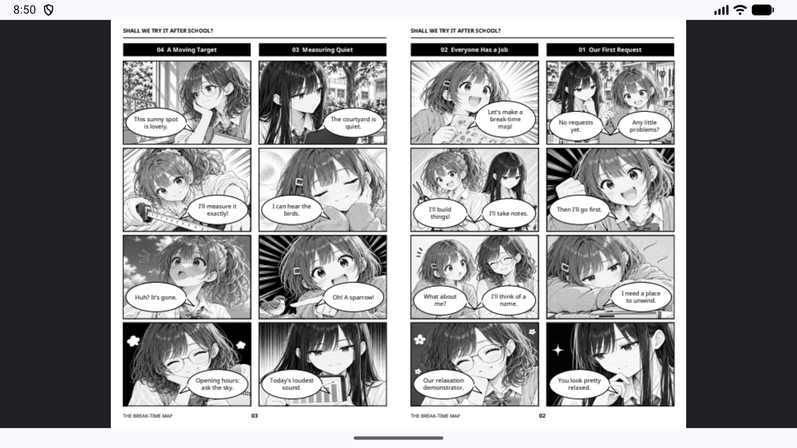
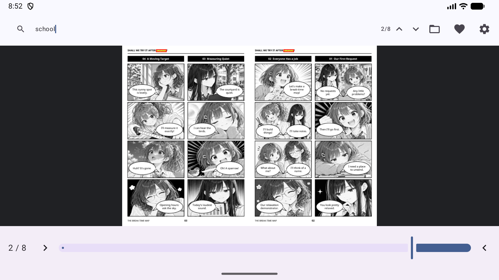
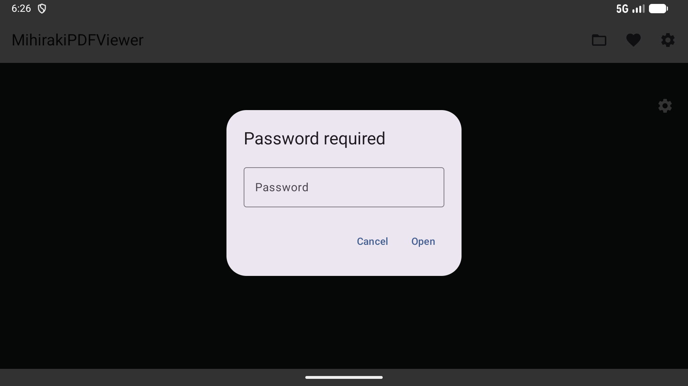
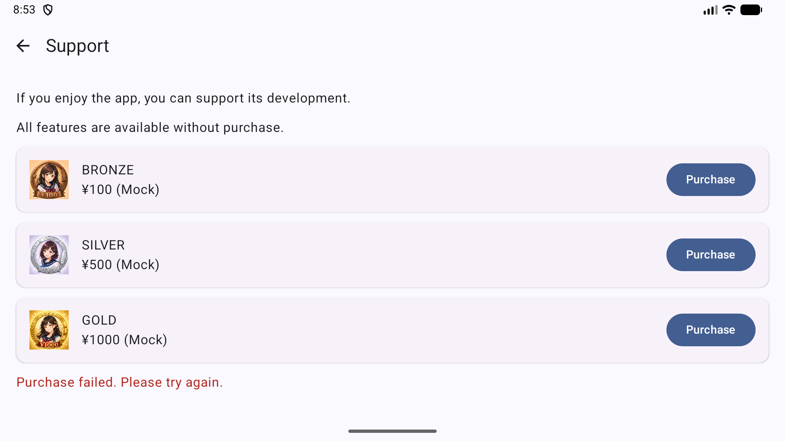
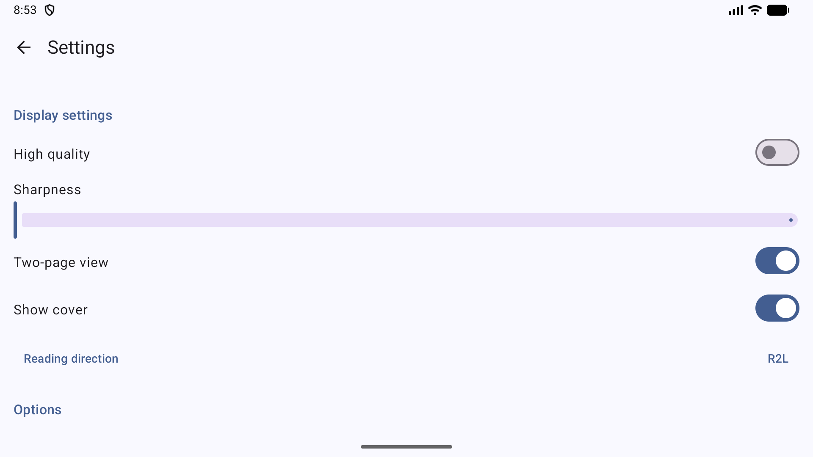

# Mihiraki: Two-Page PDF Reader for Android

[](https://play.google.com/store/apps/details?id=com.github.tyamada.MihirakiPDFViewer_Android)
[](LICENSE)
[](https://qiita.com/tyamada22/stocks/8aeb6d899f7e0257f1d2)

English | [日本語](README_ja.md)

**Mihiraki: Two-Page PDF Reader** (MihirakiPDFViewer) is a modern, privacy-focused local PDF viewer for Android designed specifically for an optimal reading experience of two-page spreads and right-to-left (R2L) documents like Japanese Manga and Light Novels.

Built with **Kotlin**, **Jetpack Compose**, and **Material 3** following the **MVVM** architecture.

## Video guides

These videos are in English and open on YouTube.

- [Introduction](https://www.youtube.com/shorts/ethgkyCJqbI)
- [Complete quick guide](https://www.youtube.com/watch?v=I5tp84abV5o)
- [Tutorial playlist (5 videos)](https://www.youtube.com/watch?v=KhCn6C-lw7I&list=PLBBAqnUOZR-A)

## ✨ Features

- 📖 **Two-Page Spread Support**: Seamlessly view two pages side-by-side.
- 📑 **PDF Table of Contents (Outline) Tree Navigation**: Extract bookmarks and chapters from PDF metadata for instant chapter jumping.
- ☰ **Top Bar Dropdown Menu & Dedicated Screens**: Quick access to Settings, Help, Version, Diagnostics, and Support directly from the top bar dropdown menu, featuring an accordion Help screen and dedicated Version & Diagnostics hub screens.
- 🔄 **Auto-Detection**: Automatically detects page layout (Single/Spread) and reading direction (L2R/R2L) from PDF metadata.
- 🇯🇵 **R2L Support**: Native support for right-to-left reading order and right-bound book layouts.
- 🔍 **Powerful Search**: Fast text search with precise hit highlighting (yellow background and red border).
- 🛡️ **Privacy First**: PDF processing takes place on your device. Uses Storage Access Framework (SAF) to only access files you choose.
- 🚀 **Performant Rendering**: Uses Android's native `PdfRenderer` with a fallback to `PDFBox-Android` for maximum compatibility and features.
- 🎨 **Adaptive UI & Foldable Support**: Responsive design with `BoxWithConstraints` that adapts seamlessly across phones, tablets, and foldables.
- ♿ **Accessibility (A11y) & Automated Audits**: TalkBack semantics and automated Espresso AccessibilityChecks integrated into test suites.
- 🖱️ **Desktop Mouse & Edge-Click Navigation**: Intuitive page turning by clicking the left and right edges on desktop/mouse navigation mode, configurable in Settings.
- 📱 **Adaptive Portrait Display**: Automatically switches to single-page display in portrait orientation (defaulting to single-page on smartphones and spread on tablets, configurable in Settings).
- 📋 **Diagnostics & Persistent Logging**: In-app device diagnostic testing and local app log management (stored securely locally for up to 24 hours, with zero personal/file data logging and no automatic external transmission).

> [!NOTE]
> **Internet Connectivity**: Reading PDFs stored on your device works offline. Sample downloads, cloud storage, update checks, support purchases and purchase restoration require network access; opening external links also uses the network.

## 📱 Screenshots

| Viewer (Spread) | Search | Password Protection | Support | Settings |
| :---: | :---: | :---: | :---: | :---: |
|  |  |  |  |  |

## 🛠 Tech Stack

- **Language**: [Kotlin](https://kotlinlang.org/)
- **UI Framework**: [Jetpack Compose](https://developer.android.com/jetpack/compose)
- **Design System**: [Material 3](https://m3.material.io/)
- **Architecture**: MVVM (Model-View-ViewModel)
- **PDF Engine**: Native `PdfRenderer` + [PDFBox-Android](https://github.com/TomRoush/PdfBox-Android)
- **Local Storage**: [Jetpack DataStore](https://developer.android.com/topic/libraries/architecture/datastore) (Preferences)
- **Navigation**: [Jetpack Navigation Compose](https://developer.android.com/jetpack/compose/navigation)
- **In-App Billing**: [Google Play Billing Library](https://developer.android.com/google/play/billing) (for developer support tips)

## 🚀 Getting Started

### Prerequisites
- Android Studio with JDK 21 and support for the project’s Gradle/Android Gradle Plugin versions
- JDK 21
- Android SDK 37

### Build
1. Clone the repository:
   ```bash
   git clone https://github.com/tyamada/MihirakiPDFViewer_Android.git
   ```
2. Open the project in Android Studio.
3. Sync the project with Gradle files.
4. Run the app on an emulator or a physical device (minSdk 26).

## 📚 Sample PDFs

Sample PDFs start with the latest episode. Switch to Episode 1 first or latest first; your order is saved and also applies when filtering by language.

Try out MihirakiPDFViewer with these sample PDF files:
51 PDFs in 14 languages and 17 language/region variants, with three episodes each. Spain and Latin America, Brazil and Portugal, and Taiwan and Hong Kong have separate filters. The Hong Kong edition uses standard written Chinese, not colloquial Cantonese. Downloads are verified against their expected size and SHA-256; older PDFs are retained.

The links below are sorted by English language name, then Episode 1–3.

- [试试社 第1话 歇口气地图 — 简体中文 (Chinese (Simplified)) — 小真彩日和](https://github.com/tyamada/MihirakiPDFViewer_Android/releases/download/sample-manga-v2/tameshibu_episode1_2_zh_cn.pdf) (23.1 MiB)
- [试试社 第2话 桌子变大了 — 简体中文 (Chinese (Simplified)) — 小真彩日和](https://github.com/tyamada/MihirakiPDFViewer_Android/releases/download/sample-manga-v2/tameshibu_episode2_2_zh_cn.pdf) (23.9 MiB)
- [第3话 / 试试社，出差啦！ — 简体中文 (Chinese (Simplified)) — 小真彩日和](https://github.com/tyamada/MihirakiPDFViewer_Android/releases/download/sample-manga-v2/tameshibu_episode3_2_zh_cn.pdf) (22.2 MiB)
- [試試社 第1話 歇口氣地圖 \[zh-Hant-HK\] — 繁體中文（香港書面語） (Chinese (Traditional, Hong Kong written standard)) — 小舞樓日和](https://github.com/tyamada/MihirakiPDFViewer_Android/releases/download/sample-manga-v2/tameshibu_episode1_3_zh_hk.pdf) (23.1 MiB)
- [試試社 第2話 桌子變大了 \[zh-Hant-HK\] — 繁體中文（香港書面語） (Chinese (Traditional, Hong Kong written standard)) — 小舞樓日和](https://github.com/tyamada/MihirakiPDFViewer_Android/releases/download/sample-manga-v2/tameshibu_episode2_3_zh_hk.pdf) (24.0 MiB)
- [第3話 / 試試社，出差啦！ \[zh-Hant-HK\] — 繁體中文（香港書面語） (Chinese (Traditional, Hong Kong written standard)) — 小舞樓日和](https://github.com/tyamada/MihirakiPDFViewer_Android/releases/download/sample-manga-v2/tameshibu_episode3_2_zh_hk.pdf) (22.2 MiB)
- [試試社 第1話 歇口氣地圖 — 繁體中文（台灣） (Chinese (Traditional, Taiwan)) — 小舞樓日和](https://github.com/tyamada/MihirakiPDFViewer_Android/releases/download/sample-manga-v2/tameshibu_episode1_2_zh_tw.pdf) (23.1 MiB)
- [試試社 第2話 桌子變大了 — 繁體中文（台灣） (Chinese (Traditional, Taiwan)) — 小舞樓日和](https://github.com/tyamada/MihirakiPDFViewer_Android/releases/download/sample-manga-v2/tameshibu_episode2_2_zh_tw.pdf) (23.9 MiB)
- [第3話 / 試試社，出差啦！ — 繁體中文（台灣） (Chinese (Traditional, Taiwan)) — 小舞樓日和](https://github.com/tyamada/MihirakiPDFViewer_Android/releases/download/sample-manga-v2/tameshibu_episode3_2_zh_tw.pdf) (22.2 MiB)
- [The Try-It Club - Episode 1: The Break-Time Map — English — こまいろ日和 / Komairo Hiyori](https://github.com/tyamada/MihirakiPDFViewer_Android/releases/download/sample-manga-v2/tameshibu_episode1_3_en.pdf) (23.1 MiB)
- [The Try-It Club - Episode 2: Room to Grow — English — こまいろ日和 / Komairo Hiyori](https://github.com/tyamada/MihirakiPDFViewer_Android/releases/download/sample-manga-v2/tameshibu_episode2_3_en.pdf) (23.9 MiB)
- [The Try-It Club - Episode 3: Out and About — English — こまいろ日和 / Komairo Hiyori](https://github.com/tyamada/MihirakiPDFViewer_Android/releases/download/sample-manga-v2/tameshibu_episode3_2_en.pdf) (22.3 MiB)
- [CLUB NG MGA PAGSUBOK - KABANATA 1 / MAPA NG PAHINGAHAN — Filipino — こまいろ日和 / Komairo Hiyori](https://github.com/tyamada/MihirakiPDFViewer_Android/releases/download/sample-manga-v2/tameshibu_episode1_3_tl.pdf) (24.5 MiB)
- [CLUB NG MGA PAGSUBOK - KABANATA 2 / LUMUWANG ANG MESA — Filipino — こまいろ日和 / Komairo Hiyori](https://github.com/tyamada/MihirakiPDFViewer_Android/releases/download/sample-manga-v2/tameshibu_episode2_3_tl.pdf) (25.0 MiB)
- [CLUB NG MGA PAGSUBOK - KABANATA 3 / LUMABAS ANG CLUB — Filipino — こまいろ日和 / Komairo Hiyori](https://github.com/tyamada/MihirakiPDFViewer_Android/releases/download/sample-manga-v2/tameshibu_episode3_2_tl.pdf) (23.8 MiB)
- [Le Club des essais - Épisode 1 : Le plan des coins détente — Français (French) — こまいろ日和 / Komairo Hiyori](https://github.com/tyamada/MihirakiPDFViewer_Android/releases/download/sample-manga-v2/tameshibu_episode1_3_fr.pdf) (23.0 MiB)
- [Le Club des essais - Épisode 2 : La table s’agrandit — Français (French) — こまいろ日和 / Komairo Hiyori](https://github.com/tyamada/MihirakiPDFViewer_Android/releases/download/sample-manga-v2/tameshibu_episode2_3_fr.pdf) (23.9 MiB)
- [Le Club des essais - Épisode 3 : Le club en sortie — Français (French) — こまいろ日和 / Komairo Hiyori](https://github.com/tyamada/MihirakiPDFViewer_Android/releases/download/sample-manga-v2/tameshibu_episode3_2_fr.pdf) (22.2 MiB)
- [Der Probierclub - Folge 1: Die Pausenkarte — Deutsch (German) — こまいろ日和 / Komairo Hiyori](https://github.com/tyamada/MihirakiPDFViewer_Android/releases/download/sample-manga-v2/tameshibu_episode1_3_de.pdf) (23.0 MiB)
- [Der Probierclub - Folge 2: Mehr Platz am Tisch — Deutsch (German) — こまいろ日和 / Komairo Hiyori](https://github.com/tyamada/MihirakiPDFViewer_Android/releases/download/sample-manga-v2/tameshibu_episode2_3_de.pdf) (23.9 MiB)
- [Der Probierclub - Folge 3: Unterwegs — Deutsch (German) — こまいろ日和 / Komairo Hiyori](https://github.com/tyamada/MihirakiPDFViewer_Android/releases/download/sample-manga-v2/tameshibu_episode3_2_de.pdf) (22.2 MiB)
- [KLUB COBA-COBA - EPISODE 1 / PETA TEMPAT ISTIRAHAT — Bahasa Indonesia (Indonesian) — こまいろ日和 / Komairo Hiyori](https://github.com/tyamada/MihirakiPDFViewer_Android/releases/download/sample-manga-v2/tameshibu_episode1_3_id.pdf) (24.1 MiB)
- [KLUB COBA-COBA - EPISODE 2 / MEJANYA MAKIN LUAS — Bahasa Indonesia (Indonesian) — こまいろ日和 / Komairo Hiyori](https://github.com/tyamada/MihirakiPDFViewer_Android/releases/download/sample-manga-v2/tameshibu_episode2_3_id.pdf) (25.0 MiB)
- [KLUB COBA-COBA - EPISODE 3 / KLUB JALAN-JALAN — Bahasa Indonesia (Indonesian) — こまいろ日和 / Komairo Hiyori](https://github.com/tyamada/MihirakiPDFViewer_Android/releases/download/sample-manga-v2/tameshibu_episode3_2_id.pdf) (24.2 MiB)
- [IL CLUB DEGLI ESPERIMENTI - EPISODIO 1 / LA MAPPA DELLE PAUSE — Italiano (Italian) — こまいろ日和 / Komairo Hiyori](https://github.com/tyamada/MihirakiPDFViewer_Android/releases/download/sample-manga-v2/tameshibu_episode1_3_it.pdf) (23.1 MiB)
- [IL CLUB DEGLI ESPERIMENTI - EPISODIO 2 / IL TAVOLO SI ALLARGA — Italiano (Italian) — こまいろ日和 / Komairo Hiyori](https://github.com/tyamada/MihirakiPDFViewer_Android/releases/download/sample-manga-v2/tameshibu_episode2_3_it.pdf) (23.9 MiB)
- [IL CLUB DEGLI ESPERIMENTI - EPISODIO 3 / IL CLUB IN TRASFERTA — Italiano (Italian) — こまいろ日和 / Komairo Hiyori](https://github.com/tyamada/MihirakiPDFViewer_Android/releases/download/sample-manga-v2/tameshibu_episode3_2_it.pdf) (22.3 MiB)
- [ためし部 第1話 ひと息マップ — 日本語 (Japanese) — こまいろ日和 / Komairo Hiyori](https://github.com/tyamada/MihirakiPDFViewer_Android/releases/download/sample-manga-v2/tameshibu_episode1_2_ja.pdf) (23.1 MiB)
- [ためし部 第2話 机、ひろがる。 — 日本語 (Japanese) — こまいろ日和 / Komairo Hiyori](https://github.com/tyamada/MihirakiPDFViewer_Android/releases/download/sample-manga-v2/tameshibu_episode2_2_ja.pdf) (23.9 MiB)
- [ためし部 第3話 出張、ためし部！ — 日本語 (Japanese) — こまいろ日和 / Komairo Hiyori](https://github.com/tyamada/MihirakiPDFViewer_Android/releases/download/sample-manga-v2/tameshibu_episode3_ja.pdf) (22.2 MiB)
- [해봄부 제1화 한숨 돌림 지도 — 한국어 (Korean) — こまいろ日和 / Komairo Hiyori](https://github.com/tyamada/MihirakiPDFViewer_Android/releases/download/sample-manga-v2/tameshibu_episode1_2_ko.pdf) (23.0 MiB)
- [해봄부 제2화 책상이 넓어지다 — 한국어 (Korean) — こまいろ日和 / Komairo Hiyori](https://github.com/tyamada/MihirakiPDFViewer_Android/releases/download/sample-manga-v2/tameshibu_episode2_2_ko.pdf) (23.8 MiB)
- [제3화 / 해봄부, 출장! — 한국어 (Korean) — こまいろ日和 / Komairo Hiyori](https://github.com/tyamada/MihirakiPDFViewer_Android/releases/download/sample-manga-v2/tameshibu_episode3_2_ko.pdf) (22.2 MiB)
- [प्रयोग क्लब - भाग 1 / आरामको नक्सा — नेपाली (Nepali) — こまいろ日和 / Komairo Hiyori](https://github.com/tyamada/MihirakiPDFViewer_Android/releases/download/sample-manga-v2/tameshibu_episode1_3_ne.pdf) (25.7 MiB)
- [प्रयोग क्लब - भाग 2 / टेबुल फराकिलो भयो — नेपाली (Nepali) — こまいろ日和 / Komairo Hiyori](https://github.com/tyamada/MihirakiPDFViewer_Android/releases/download/sample-manga-v2/tameshibu_episode2_3_ne.pdf) (26.6 MiB)
- [प्रयोग क्लब - भाग 3 / क्लबको पहिलो भ्रमण — नेपाली (Nepali) — こまいろ日和 / Komairo Hiyori](https://github.com/tyamada/MihirakiPDFViewer_Android/releases/download/sample-manga-v2/tameshibu_episode3_2_ne.pdf) (23.7 MiB)
- [O CLUBE DAS EXPERIÊNCIAS - EPISÓDIO 1 / MAPA DO DESCANSO — Português (Brasil) (Portuguese (Brazil)) — こまいろ日和 / Komairo Hiyori](https://github.com/tyamada/MihirakiPDFViewer_Android/releases/download/sample-manga-v2/tameshibu_episode1_3_pt.pdf) (23.1 MiB)
- [O CLUBE DAS EXPERIÊNCIAS - EPISÓDIO 2 / A MESA CRESCE — Português (Brasil) (Portuguese (Brazil)) — こまいろ日和 / Komairo Hiyori](https://github.com/tyamada/MihirakiPDFViewer_Android/releases/download/sample-manga-v2/tameshibu_episode2_3_pt.pdf) (23.9 MiB)
- [O CLUBE DAS EXPERIÊNCIAS - EPISÓDIO 3 / O CLUBE VAI À BIBLIOTECA — Português (Brasil) (Portuguese (Brazil)) — こまいろ日和 / Komairo Hiyori](https://github.com/tyamada/MihirakiPDFViewer_Android/releases/download/sample-manga-v2/tameshibu_episode3_2_pt.pdf) (22.3 MiB)
- [O CLUBE DAS EXPERIÊNCIAS - EPISÓDIO 1 / MAPA DO DESCANSO \[pt-PT\] — Português (Portugal) (Portuguese (Portugal)) — こまいろ日和 / Komairo Hiyori](https://github.com/tyamada/MihirakiPDFViewer_Android/releases/download/sample-manga-v2/tameshibu_episode1_3_pt_pt.pdf) (23.2 MiB)
- [O CLUBE DAS EXPERIÊNCIAS - EPISÓDIO 2 / A MESA CRESCE \[pt-PT\] — Português (Portugal) (Portuguese (Portugal)) — こまいろ日和 / Komairo Hiyori](https://github.com/tyamada/MihirakiPDFViewer_Android/releases/download/sample-manga-v2/tameshibu_episode2_3_pt_pt.pdf) (24.0 MiB)
- [O CLUBE DAS EXPERIÊNCIAS - EPISÓDIO 3 / O CLUBE VAI À BIBLIOTECA \[pt-PT\] — Português (Portugal) (Portuguese (Portugal)) — こまいろ日和 / Komairo Hiyori](https://github.com/tyamada/MihirakiPDFViewer_Android/releases/download/sample-manga-v2/tameshibu_episode3_2_pt_pt.pdf) (22.3 MiB)
- [EL CLUB DE LOS EXPERIMENTOS - EPISODIO 1 / MAPA DE DESCANSOS \[es-419\] — Español (Latinoamérica) (Spanish (Latin America)) — こまいろ日和 / Komairo Hiyori](https://github.com/tyamada/MihirakiPDFViewer_Android/releases/download/sample-manga-v2/tameshibu_episode1_3_es_419.pdf) (23.1 MiB)
- [EL CLUB DE LOS EXPERIMENTOS - EPISODIO 2 / LA MESA CRECE \[es-419\] — Español (Latinoamérica) (Spanish (Latin America)) — こまいろ日和 / Komairo Hiyori](https://github.com/tyamada/MihirakiPDFViewer_Android/releases/download/sample-manga-v2/tameshibu_episode2_3_es_419.pdf) (23.9 MiB)
- [EL CLUB DE LOS EXPERIMENTOS - EPISODIO 3 / DE SALIDA \[es-419\] — Español (Latinoamérica) (Spanish (Latin America)) — こまいろ日和 / Komairo Hiyori](https://github.com/tyamada/MihirakiPDFViewer_Android/releases/download/sample-manga-v2/tameshibu_episode3_2_es_419.pdf) (22.3 MiB)
- [EL CLUB DE LOS EXPERIMENTOS - EPISODIO 1 / MAPA DE DESCANSOS — Español (España) (Spanish (Spain)) — こまいろ日和 / Komairo Hiyori](https://github.com/tyamada/MihirakiPDFViewer_Android/releases/download/sample-manga-v2/tameshibu_episode1_3_es.pdf) (23.0 MiB)
- [EL CLUB DE LOS EXPERIMENTOS - EPISODIO 2 / LA MESA CRECE — Español (España) (Spanish (Spain)) — こまいろ日和 / Komairo Hiyori](https://github.com/tyamada/MihirakiPDFViewer_Android/releases/download/sample-manga-v2/tameshibu_episode2_3_es.pdf) (23.9 MiB)
- [EL CLUB DE LOS EXPERIMENTOS - EPISODIO 3 / DE SALIDA — Español (España) (Spanish (Spain)) — こまいろ日和 / Komairo Hiyori](https://github.com/tyamada/MihirakiPDFViewer_Android/releases/download/sample-manga-v2/tameshibu_episode3_2_es.pdf) (22.3 MiB)
- [CÂU LẠC BỘ THỬ NGHIỆM - TẬP 1 / BẢN ĐỒ CHỖ NGHỈ — Tiếng Việt (Vietnamese) — こまいろ日和 / Komairo Hiyori](https://github.com/tyamada/MihirakiPDFViewer_Android/releases/download/sample-manga-v2/tameshibu_episode1_3_vi.pdf) (24.8 MiB)
- [CÂU LẠC BỘ THỬ NGHIỆM - TẬP 2 / CHIẾC BÀN RỘNG HƠN — Tiếng Việt (Vietnamese) — こまいろ日和 / Komairo Hiyori](https://github.com/tyamada/MihirakiPDFViewer_Android/releases/download/sample-manga-v2/tameshibu_episode2_3_vi.pdf) (25.5 MiB)
- [CÂU LẠC BỘ THỬ NGHIỆM - TẬP 3 / CÂU LẠC BỘ ĐI CÔNG TÁC — Tiếng Việt (Vietnamese) — こまいろ日和 / Komairo Hiyori](https://github.com/tyamada/MihirakiPDFViewer_Android/releases/download/sample-manga-v2/tameshibu_episode3_2_vi.pdf) (24.3 MiB)

### Sample PDF License & Attribution
**"The Try-It Club" Episodes 1–3**
© 2026 Komairo Hiyori

Parts of this work to which the publisher holds copyright and other licensable rights are provided under the Creative Commons Attribution 4.0 International (CC BY 4.0) license.
https://creativecommons.org/licenses/by/4.0/

When reusing this work, please display the title, author name "Komairo Hiyori", the publisher of the original work, and a link to the license, and clearly indicate if any changes were made.

This work uses generative AI for the creation of text, images, and translation. Materials whose rights belong to third parties, such as fonts, are subject to their respective licenses. This notice does not restrict the use of parts of the work that are not protected by copyright or similar rights.

## 🧪 Testing & Diagnostics
Run unit tests and instrumented UI tests. Test PDF files are available [here](https://1drv.ms/f/c/7a27b2713c2c2c38/IgDLhBYHJMKbRrvH92OpdA6jAQ4VUZNjFrJhqSYs9W4-BTo?e=JaNqSa).
```bash
./gradlew test
./gradlew connectedAndroidTest
```
- **Installed Play app evidence (no installation or app-data changes)**: `python3 scripts/run_device_tests_and_save.py --serial DEVICE_SERIAL` records the installed version and selected device properties in `logs/`. This is evidence collection, not a functional test pass. Follow the [manual update checklist](docs/DEVICE_TEST_CHECKLIST.ja.md) for settings retention, purchases and TalkBack.
- **Debug automation on a dedicated test device**: `python3 scripts/run_device_tests_and_save.py --serial DEVICE_SERIAL --mode debug` builds and installs Debug with data retention, then runs startup, unit, instrumentation and Python checks. A Play installation is protected from replacement. For a clean Debug test only, add `--clean-install --confirm-clean DEVICE_SERIAL`; this deletes the test app’s data. Every required failure returns a nonzero status. Manual checks remain pending and the compatibility list is never automatically overwritten.
- See the [device testing guide](DEV_TESTING_GUIDE.md) for environment setup, reports and limitations. Review logs before sharing.
- **In-App Diagnostics**: Access "Testing & Diagnostics" in Settings to inspect real-time memory usage and rolling application logs (`AppLogger`).
- **Performance & Stress Tests**: Includes automated memory tracking, rapid page navigation stress tests, and multi-document switching stability tests.

## 🤖 CI (Continuous Integration)
An automated build and test verification pipeline is established using GitHub Actions (`.github/workflows/ci.yml`).
- **Target Branches**: `main`, `testing` (on push and pull requests)
- **Checks Performed**:
  - JDK 21 environment setup
  - Debug APK build (`./gradlew assembleDebug`)
  - Android Lint (`./gradlew lintDebug`)
  - JVM unit tests execution (`./gradlew testDebugUnitTest`)
  - Translation/resource, store metadata and public-page validation; device runner regression tests
  - Test and Lint reports saved as CI artifacts; no signing keys are required

## 📋 Verification List
Device compatibility and verification results tested by developers and users are documented in [VERIFICATION_LIST.md](VERIFICATION_LIST.md).

## 💖 Support the Developer
If you find this app useful, you can support further development via the in-app "Support" feature. We offer Bronze, Silver, Gold, and Ver.2.0 Release Commemoration Koyomi Badge tip tiers, which unlock special commemorative badges in your settings screen! (Play Console promotion codes are also supported for free badge redemption).

## 🐛 Reporting Issues & Bug Reports
If you encounter any bugs, crashes, or unexpected behavior, please open an issue on [GitHub Issues](https://github.com/tyamada/MihirakiPDFViewer_Android/issues). 
When reporting an issue, please include:
1. **App Version & Build Code** (e.g., v2.1.4, Code 43)
2. **Device Model & Android Version** (e.g., Pixel 8, Android 15)
3. **Steps to Reproduce** the problem
4. **Diagnostic Logs**: Copy or share app logs from **Settings > Testing & Diagnostics** Review logs and remove private information before attaching them.

## 📖 Qiita Series / Articles
Development articles and series logs are available in the [Qiita Series Stock List](https://qiita.com/tyamada22/stocks/8aeb6d899f7e0257f1d2).

## 🤖 Developed with AI
This project was developed with the assistance of AI:
- **Initial Code Generation**: [ChatGPT](https://chat.openai.com/)
- **Modifications, Feature Implementation & Bug Fixes**: [Gemini 3.0 Flash Preview](https://deepmind.google/technologies/gemini/flash/) (via Android Studio)

## 📜 Version History

- **v2.1.5 (Code 45) — local release candidate, not published**
  - Updated sample manga to 51 PDFs in 17 language/region variants; verified downloads and retained legacy PDFs.
  - [Release preparation and device checks](docs/SAMPLE_PDF_V2_RELEASE_45.ja.md).

- **v2.1.4 (Code 44) — internal testing, 2026-11-02**
  - Fixed the enlarged-font Support screen: scroll through all tiers, with product details and purchase controls arranged vertically. The support scrolling, TalkBack and purchased-status retest passed on Pixel 8a (Android 17), as reported by the tester.

- **v2.1.4 (Code 43) — internal testing, 2026-11-02**
  - Saved sample PDF sorting, translation and icon updates, improved screen reader labels, compact search controls, external PDF navigation and settings persistence.
  - Physical-device update retention, purchase restoration and TalkBack checks are in progress. This is not a production release announcement.
- **v2.1.3 (Code 42) — production baseline**
  - The production version recorded before the internal test rollout. See [GitHub Releases](https://github.com/tyamada/MihirakiPDFViewer_Android/releases) for older published tags.

Older README entries repeated version 2.1.3 for unrelated changes. They have been removed rather than assigning unsupported historical version numbers. The Git history retains the original records. Support purchases are non-consumable Google Play products; they do not unlock reading features.

## 📄 License
This project is licensed under the MIT License - see the [LICENSE](LICENSE) file for details.

---
*Note: This app is optimized for local file viewing and does not upload your documents to any server.*

### Sample PDF distribution

The 51 sample manga PDFs are distributed through [GitHub Releases](https://github.com/tyamada/MihirakiPDFViewer_Android/releases/tag/sample-manga-v2). Existing GitHub Pages PDF URLs remain available for older app versions. See [migration and verification notes](docs/SAMPLE_PDF_RELEASE_MIGRATION.ja.md).

[Sample v2 implementation and verification](docs/SAMPLE_PDF_V2_UPDATE.ja.md)

Sample list maintenance: run `python3 scripts/sample_public_catalog.py --write` to regenerate the lists from the published manifest and app language names. Run `python3 scripts/verify_sample_release_assets.py` to check every README and public index page, including missing lists, labels, sizes and order.
