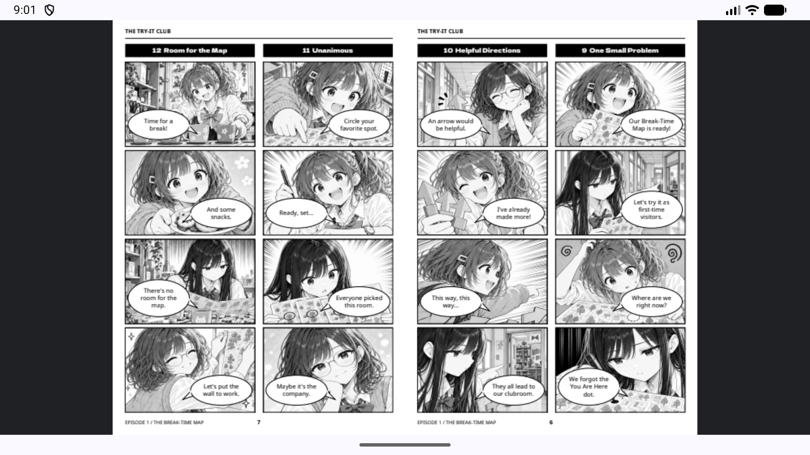
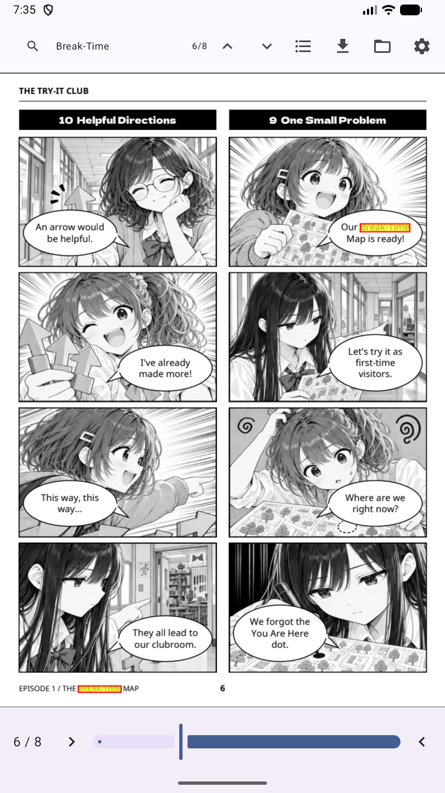
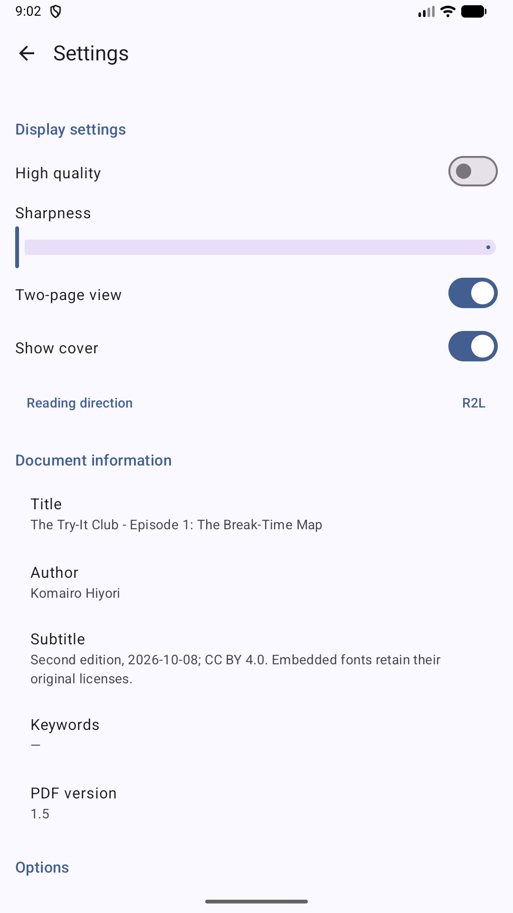
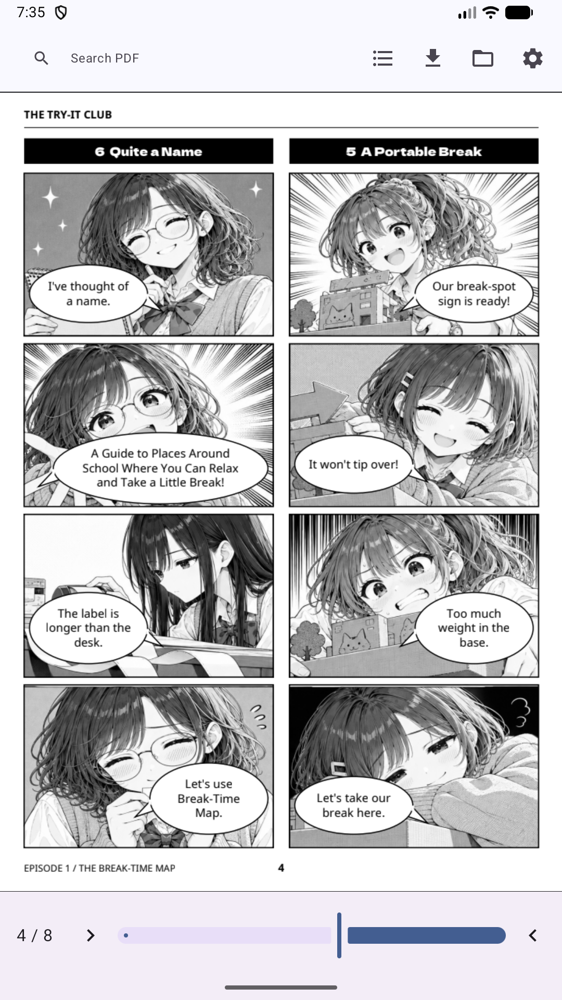
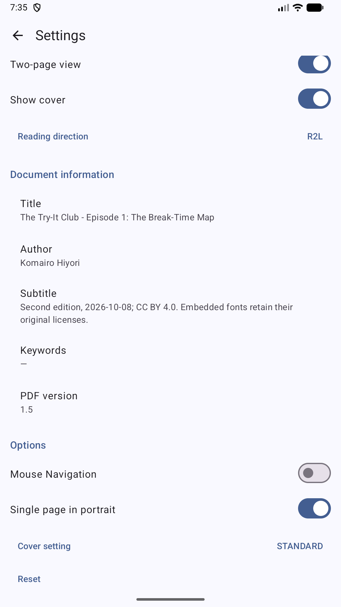

# Mihiraki: Two-Page PDF Reader for Android

[](https://play.google.com/store/apps/details?id=com.github.tyamada.MihirakiPDFViewer_Android)
[](LICENSE)
[](https://qiita.com/tyamada22/stocks/8aeb6d899f7e0257f1d2)

English | [日本語](README_ja.md)

**Mihiraki: Two-Page PDF Reader** (MihirakiPDFViewer) is a modern, privacy-focused local PDF viewer for Android designed specifically for an optimal reading experience of two-page spreads and right-to-left (R2L) documents like Japanese Manga and Light Novels.

Built with **Kotlin**, **Jetpack Compose**, and **Material 3** following the **MVVM** architecture.

## Video guides

These videos are in English and open on YouTube.

- [Introduction](https://www.youtube.com/shorts/ethgkyCJqbI)
- [Complete quick guide](https://www.youtube.com/watch?v=I5tp84abV5o)
- [Tutorial playlist (5 videos)](https://www.youtube.com/watch?v=KhCn6C-lw7I&list=PLBBAqnUOZR-A)

## ✨ Features

- 📖 **Two-Page Spread Support**: Seamlessly view two pages side-by-side.
- 📑 **PDF Table of Contents (Outline) Tree Navigation**: Extract bookmarks and chapters from PDF metadata for instant chapter jumping.
- ☰ **Top Bar Dropdown Menu & Dedicated Screens**: Quick access to Settings, Help, Version, Diagnostics, and Support directly from the top bar dropdown menu, featuring an accordion Help screen and dedicated Version & Diagnostics hub screens.
- 🔄 **Auto-Detection**: Automatically detects page layout (Single/Spread) and reading direction (L2R/R2L) from PDF metadata.
- 🇯🇵 **R2L Support**: Native support for right-to-left reading order and right-bound book layouts.
- 🔍 **Powerful Search**: Fast text search with precise hit highlighting (yellow background and red border).
- 🛡️ **Privacy First**: PDF processing takes place on your device. Uses Storage Access Framework (SAF) to only access files you choose.
- 🚀 **Performant Rendering**: Uses Android's native `PdfRenderer` with a fallback to `PDFBox-Android` for maximum compatibility and features.
- 🎨 **Adaptive UI & Foldable Support**: Responsive design with `BoxWithConstraints` that adapts seamlessly across phones, tablets, and foldables.
- ♿ **Accessibility (A11y) & Automated Audits**: TalkBack semantics and automated Espresso AccessibilityChecks integrated into test suites.
- 🖱️ **Desktop Mouse & Edge-Click Navigation**: Intuitive page turning by clicking the left and right edges on desktop/mouse navigation mode, configurable in Settings.
- 📱 **Adaptive Portrait Display**: Automatically switches to single-page display in portrait orientation (defaulting to single-page on smartphones and spread on tablets, configurable in Settings).
- 📋 **Diagnostics & Persistent Logging**: In-app device diagnostic testing and local app log management (stored securely locally for up to 24 hours, with zero personal/file data logging and no automatic external transmission).

> [!NOTE]
> **Internet Connectivity**: Reading PDFs stored on your device works offline. Sample downloads, cloud storage, update checks, support purchases and purchase restoration require network access; opening external links also uses the network.

## 📱 Screenshots

| Viewer | Search | Reading settings | Page navigation | Display settings |
| :---: | :---: | :---: | :---: | :---: |
|  |  |  |  |  |

## 🛠 Tech Stack

- **Language**: [Kotlin](https://kotlinlang.org/)
- **UI Framework**: [Jetpack Compose](https://developer.android.com/jetpack/compose)
- **Design System**: [Material 3](https://m3.material.io/)
- **Architecture**: MVVM (Model-View-ViewModel)
- **PDF Engine**: Native `PdfRenderer` + [PDFBox-Android](https://github.com/TomRoush/PdfBox-Android)
- **Local Storage**: [Jetpack DataStore](https://developer.android.com/topic/libraries/architecture/datastore) (Preferences)
- **Navigation**: [Jetpack Navigation Compose](https://developer.android.com/jetpack/compose/navigation)
- **In-App Billing**: [Google Play Billing Library](https://developer.android.com/google/play/billing) (for developer support tips)

## 🚀 Getting Started

### Development setup, build and installation

- JDK 21. The Gradle daemon selects JetBrains JDK 21; the toolchain resolver downloads it if needed.
- Android SDK Platform 37.0, Build Tools 36.0.0 and Platform Tools.
- For IDE use, select Android Studio compatible with this repository's Gradle/AGP versions.
- Install the SDK using Android Studio's SDK Manager or the [official command-line tools](https://developer.android.com/tools/sdkmanager), and accept the SDK licenses.

```bash
git clone https://github.com/tyamada/MihirakiPDFViewer_Android.git
cd MihirakiPDFViewer_Android
# Set JAVA_HOME to JDK 21 and ANDROID_HOME to your Android SDK directory.
sdkmanager "platforms;android-37.0" "build-tools;36.0.0" "platform-tools"
sdkmanager --licenses
./gradlew assembleDebug lintDebug testDebugUnitTest
# Connect one test device with USB debugging enabled, or start one emulator.
./gradlew installDebug
```

Use `gradlew.bat` on Windows. Set the SDK location through `ANDROID_HOME` or `sdk.dir=/absolute/path/to/Android/sdk` in the ignored `local.properties`. In Android Studio, open the project, sync Gradle and select Run. Android 8.0 (API 26) or later is required.

The APK is `app/build/outputs/apk/debug/app-debug.apk`. Debug builds use an automatically generated development key; the author's signing key is unnecessary. A Debug APK cannot replace the Play app with the same application ID and a different signature. Use a dedicated test device.

### Release signing

Generate your own distribution key. The author's private key is not distributed.

```bash
keytool -genkeypair -v -keystore /absolute/private/path/release-key.jks -alias release -keyalg RSA -keysize 3072 -validity 10000
```

Enter passwords interactively. Add the following to the ignored `local.properties`, replacing password placeholders with your own values:

```properties
signing.storeFile=/absolute/private/path/release-key.jks
signing.storePassword=YOUR_STORE_PASSWORD
signing.keyAlias=release
signing.keyPassword=YOUR_KEY_PASSWORD
```

Run `./gradlew bundleRelease` to create `app/build/outputs/bundle/release/app-release.aab`. Keep keys, passwords, `local.properties` and signed artifacts out of Git. Optional Python tooling dependencies are listed in `requirements-play-console.txt`; normal app builds do not require Play Console credentials.

## 📚 Sample PDFs

[Download sample PDFs](https://tyamada.github.io/manga-prompt-kit/samples/en/)

The sample PDFs are hosted in the production-materials repository’s [pinned release](https://github.com/tyamada/manga-prompt-kit/releases/tag/manga-pdf-20261103-v1). Their content and existing download identities are preserved.

## 🧪 Testing & Diagnostics
Run unit tests and instrumented UI tests. Test PDF files are available [here](https://1drv.ms/f/c/7a27b2713c2c2c38/IgDLhBYHJMKbRrvH92OpdA6jAQ4VUZNjFrJhqSYs9W4-BTo?e=JaNqSa).
```bash
./gradlew test
./gradlew connectedAndroidTest
```
- **Installed Play app evidence (no installation or app-data changes)**: `python3 scripts/run_device_tests_and_save.py --serial DEVICE_SERIAL` records the installed version and selected device properties in `logs/`. This is evidence collection, not a functional test pass. Follow the [manual update checklist](docs/DEVICE_TEST_CHECKLIST.ja.md) for settings retention, purchases and TalkBack.
- **Debug automation on a dedicated test device**: `python3 scripts/run_device_tests_and_save.py --serial DEVICE_SERIAL --mode debug` builds and installs Debug with data retention, then runs startup, unit, instrumentation and Python checks. A Play installation is protected from replacement. For a clean Debug test only, add `--clean-install --confirm-clean DEVICE_SERIAL`; this deletes the test app’s data. Every required failure returns a nonzero status. Manual checks remain pending and the compatibility list is never automatically overwritten.
- See the [device testing guide](DEV_TESTING_GUIDE.md) for environment setup, reports and limitations. Review logs before sharing.
- **In-App Diagnostics**: Access "Testing & Diagnostics" in Settings to inspect real-time memory usage and rolling application logs (`AppLogger`).
- **Performance & Stress Tests**: Includes automated memory tracking, rapid page navigation stress tests, and multi-document switching stability tests.

## 🤖 CI (Continuous Integration)
An automated build and test verification pipeline is established using GitHub Actions (`.github/workflows/ci.yml`).
- **Target Branches**: `main`, `testing` (on push and pull requests)
- **Checks Performed**:
  - JDK 21 environment setup
  - Debug APK build (`./gradlew assembleDebug`)
  - Android Lint (`./gradlew lintDebug`)
  - JVM unit tests execution (`./gradlew testDebugUnitTest`)
  - Translation/resource, store metadata and public-page validation; device runner regression tests
  - Test and Lint reports saved as CI artifacts; no signing keys are required

## 📋 Verification List
Device compatibility and verification results tested by developers and users are documented in [VERIFICATION_LIST.md](VERIFICATION_LIST.md).

## 💖 Support the Developer
Optional Bronze, Silver and Gold tips support development and provide commemorative badges. New sales of the Koyomi badge ended on November 19, 2026; existing badges are retained. Automatic free grants through December 31, 2027 (Japan time) and badge details were introduced in 2.1.9 (52), published on November 20, 2026 at 06:59 JST, and remain available in the current 2.1.10 (53). See [the Koyomi policy and verification record](docs/KOYOMI_FREE_BADGE_2026-11-19.ja.md).

## 🐛 Reporting Issues & Bug Reports
If you encounter any bugs, crashes, or unexpected behavior, please open an issue on [GitHub Issues](https://github.com/tyamada/MihirakiPDFViewer_Android/issues). 
When reporting an issue, please include:
1. **App Version & Build Code** (e.g., v2.1.4, Code 43)
2. **Device Model & Android Version** (e.g., Pixel 8, Android 15)
3. **Steps to Reproduce** the problem
4. **Diagnostic Logs**: Copy or share app logs from **Settings > Testing & Diagnostics** Review logs and remove private information before attaching them.

## 📖 Qiita Series / Articles
Development articles and series logs are available in the [Qiita Series Stock List](https://qiita.com/tyamada22/stocks/8aeb6d899f7e0257f1d2).

## 🤖 Developed with AI
This project was developed with the assistance of AI:
- **Initial Code Generation**: [ChatGPT](https://chat.openai.com/)
- **Modifications, Feature Implementation & Bug Fixes**: [Gemini 3.0 Flash Preview](https://deepmind.google/technologies/gemini/flash/) (via Android Studio)

## 📜 Version History

- **v2.1.10 (Code 53) — published November 20, 2026 at 18:28 JST**
  - Improved internal resource optimization to reduce the app package size.
  - Released at 100% in the existing seven countries/regions: Japan, the United States, South Korea, Taiwan, Hong Kong, Macau and Canada. Managed publishing remains on.
  - Actual installations using local-country accounts in Taiwan, Hong Kong, Macau and Canada remain **on hold and unverified**.
  - [Publication status, verification scope and follow-up](docs/RELEASE_READINESS_2.1.10_53.ja.md).

- **v2.1.9 (Code 52) — published November 20, 2026 at 06:59 JST**
  - Online sample PDF catalog updates, free Koyomi badge grants through December 31, 2027 (Japan time), refreshed Play prices/purchase status, and TalkBack focus restoration after rotation.
  - The English, Japanese and Italian store descriptions no longer advertise Koyomi purchases or promotional codes.
  - Taiwan, Hong Kong, Macau and Canada remain distribution targets. Actual installations using local-country accounts are **on hold**, not verified.
  - [Release status and verification scope](docs/RELEASE_READINESS_2.1.9_52.ja.md).

The entries below retain the status recorded at the time of each historical check.


- **v2.1.5 (Code 45) — local release candidate, not published**
  - Updated sample manga to 51 PDFs in 17 language/region variants; verified downloads and retained legacy PDFs.
  - [Release preparation and device checks](docs/SAMPLE_PDF_V2_RELEASE_45.ja.md).

- **v2.1.4 (Code 44) — internal testing, 2026-11-02**
  - Fixed the enlarged-font Support screen: scroll through all tiers, with product details and purchase controls arranged vertically. The support scrolling, TalkBack and purchased-status retest passed on Pixel 8a (Android 17), as reported by the tester.

- **v2.1.4 (Code 43) — internal testing, 2026-11-02**
  - Saved sample PDF sorting, translation and icon updates, improved screen reader labels, compact search controls, external PDF navigation and settings persistence.
  - Physical-device update retention, purchase restoration and TalkBack checks are in progress. This is not a production release announcement.
- **v2.1.3 (Code 42) — production baseline**
  - The production version recorded before the internal test rollout. See [GitHub Releases](https://github.com/tyamada/MihirakiPDFViewer_Android/releases) for older published tags.

Older README entries repeated version 2.1.3 for unrelated changes. They have been removed rather than assigning unsupported historical version numbers. The Git history retains the original records. Support purchases are non-consumable Google Play products; they do not unlock reading features.

## 📄 License
This project is licensed under the MIT License - see the [LICENSE](LICENSE) file for details.

---
*Note: This app is optimized for local file viewing and does not upload your documents to any server.*
