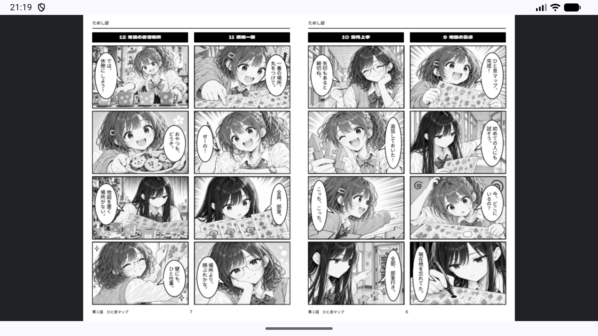
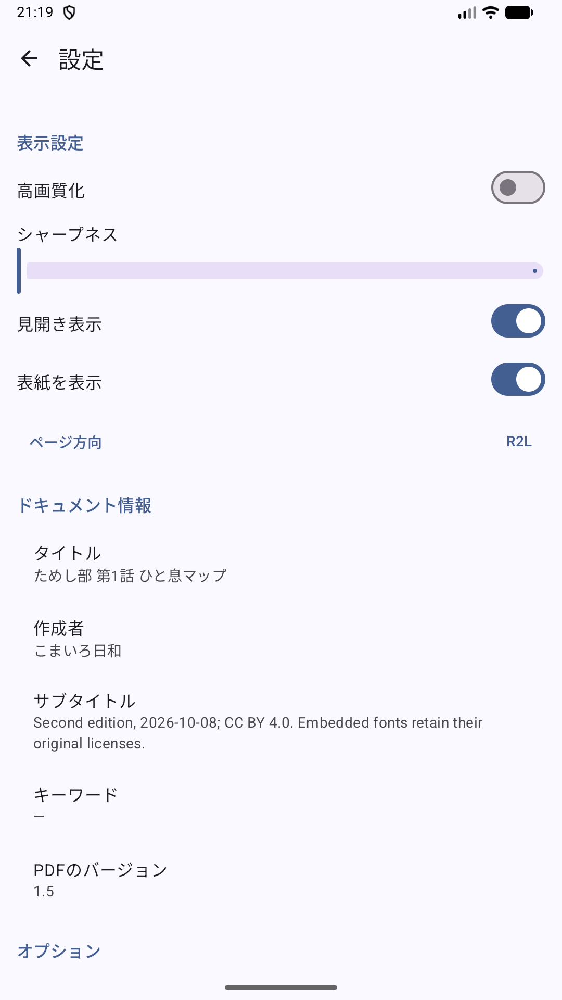
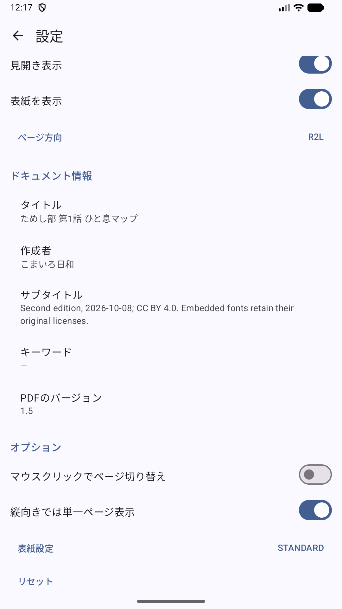

# 見開きPDFビューア (MihirakiPDFViewer) for Android

[](https://play.google.com/store/apps/details?id=com.github.tyamada.MihirakiPDFViewer_Android)
[](LICENSE)
[](https://qiita.com/tyamada22/stocks/8aeb6d899f7e0257f1d2)

[English](README.md) | 日本語

**見開きPDFビューア** (**MihirakiPDFViewer**) は、日本特有の「右綴じ」や「見開き」ドキュメント（漫画やライトノベルなど）を快適に閲覧するために設計された、プライバシー重視のモダンな Android 用ローカル PDF ビューアです。

**Kotlin**、**Jetpack Compose**、**Material 3** を使用し、**MVVM** アーキテクチャに基づいて構築されています。

## 動画ガイド

英語の動画です。YouTubeで開きます。

- [紹介動画](https://www.youtube.com/shorts/ethgkyCJqbI)
- [操作の総合ガイド（日本語）](https://www.youtube.com/watch?v=73bJ0osJYWo)
- [日本語操作ガイドの再生リスト（4本＋総合版）](https://www.youtube.com/playlist?list=PLWD24JL0mav8)

## ✨ 主な機能

- 📖 **見開き表示対応**: 2つのページを横に並べてシームレスに表示します。
- 📑 **PDF目次（アウトライン）ツリーナビゲーション**: PDFに埋め込まれた目次やブックマークを自動抽出し、ワンタップで任意の章・節へジャンプできます。
- ☰ **プルダウンメニュー & 専用画面**: トップバーの設定アイコンから「設定」「ヘルプ」「バージョン」「診断」「応援」へスムーズにアクセス。アコーディオン形式のヘルプ画面や専用のバージョン・診断ハブ画面を完備。
- 🔄 **自動構成検出**: PDF のメタデータからページレイアウト（単一/見開き）と読書方向（左綴じ/右綴じ）を自動的に検出し、最適な設定を適用します。
- 🇯🇵 **右綴じ（R2L）完全対応**: 日本の書籍特有の右から左への読書順序や、右綴じの製本レイアウトをネイティブにサポート。
- 🔍 **強力な検索機能**: 高速なテキスト検索に加え、ヒット箇所を精密にハイライト（黄色背景と赤枠）表示します。
- 🛡️ **プライバシー重視**: PDF 処理にインターネット接続は不要です。Storage Access Framework (SAF) を使用し、ユーザーが明示的に選択したファイルのみにアクセスします。
- 🚀 **高性能レンダリング**: Android 標準の `PdfRenderer` を使用し、互換性と機能向上のために `PDFBox-Android` をフォールバックとして併用します。
- 🎨 **アダプティブ UI & 折りたたみ端末対応**: `BoxWithConstraints` を活用し、スマートフォンからタブレット、折りたたみ端末まで画面サイズに最適化されたレスポンシブデザイン。
- ♿ **アクセシビリティ（A11y）対応 & 自動診断テスト**: TalkBack読み上げセマンティクスおよび Espresso AccessibilityChecks による自動テスト検証を統合。
- 🖱️ **デスクトップ・マウス端クリックページ送り**: デスクトップまたはマウス操作モードにおいて、PDF画像の左右端をクリックすることで直感的にページ送り可能（設定画面で切り替え可能）。
- 📱 **縦向きでは単一ページ表示**: 縦長画面（Portrait）のときに自動で単一ページ表示にする機能を搭載（デフォルトで有効、設定画面で切替可能）。
- 📋 **診断・アプリログ管理**: 端末診断テストの実行や、ローカルでのアプリログ保存・共有機能を搭載。ログは端末内に最大24時間安全に保存され、個人情報やファイルの内容は一切記録されません（自動外部送信なし）。

> [!NOTE]
> **インターネット接続について**: 端末内のPDF閲覧はオフラインで利用できます。サンプル取得、クラウドストレージ、更新確認、応援購入・購入情報の復元には通信が必要です。外部リンクを開く場合も通信を利用します。

## 📱 スクリーンショット

| 閲覧 | 検索 | 読書設定 | ページ移動 | 表示設定 |
| :---: | :---: | :---: | :---: | :---: |
|  |  |  |  |  |

## 🛠 技術スタック

- **言語**: [Kotlin](https://kotlinlang.org/)
- **UI フレームワーク**: [Jetpack Compose](https://developer.android.com/jetpack/compose)
- **デザインシステム**: [Material 3](https://m3.material.io/)
- **アーキテクチャ**: MVVM (Model-View-ViewModel)
- **PDF エンジン**: 標準 `PdfRenderer` + [PDFBox-Android](https://github.com/TomRoush/PdfBox-Android)
- **ローカルストレージ**: [Jetpack DataStore](https://developer.android.com/topic/libraries/architecture/datastore) (Preferences)
- **ナビゲーション**: [Jetpack Navigation Compose](https://developer.android.com/jetpack/compose/navigation)
- **アプリ内課金**: [Google Play Billing Library](https://developer.android.com/google/play/billing) (開発者応援チップ用)

## 🚀 はじめに

### 開発環境とビルド・インストール

- JDK 21（Gradle DaemonはJetBrains製JDK 21を使用。未導入時はGradleのtoolchain resolverが取得します）
- Android SDK Platform 37.0、Build Tools 36.0.0、Platform Tools
- Android Studioで開く場合は、このリポジトリのGradle/AGPバージョンに対応する版を使用してください。
- SDKはAndroid StudioのSDK Manager、または[公式のコマンドラインツール](https://developer.android.com/tools/sdkmanager)で導入します。SDKライセンスへの同意が必要です。

```bash
git clone https://github.com/tyamada/MihirakiPDFViewer_Android.git
cd MihirakiPDFViewer_Android
# JAVA_HOMEはJDK 21、ANDROID_HOMEは自身のAndroid SDKディレクトリに設定
sdkmanager "platforms;android-37.0" "build-tools;36.0.0" "platform-tools"
sdkmanager --licenses
./gradlew assembleDebug lintDebug testDebugUnitTest
# USBデバッグを許可した端末、または起動済みエミュレータ1台にインストール
./gradlew installDebug
```

Windowsでは`gradlew.bat`を使用します。SDKの場所は`ANDROID_HOME`、または追跡対象外の`local.properties`の`sdk.dir=/absolute/path/to/Android/sdk`で指定します。Android Studioではプロジェクトを開いてGradle Sync後、Runを実行できます。Android 8.0（API 26）以上が必要です。

APKの出力先は`app/build/outputs/apk/debug/app-debug.apk`です。Debugは自動生成の開発用鍵で署名され、作者の秘密鍵は不要です。Play版と署名が異なるため、同じアプリIDで上書きできません。試験用端末を使用してください。

### Release署名

自分の配布用鍵を作成します。作者の鍵は公開・配布しません。

```bash
keytool -genkeypair -v -keystore /absolute/private/path/release-key.jks -alias release -keyalg RSA -keysize 3072 -validity 10000
```

パスワードは対話入力します。追跡対象外の`local.properties`に以下を追加してください（パスワード欄は自分の値に置換）。

```properties
signing.storeFile=/absolute/private/path/release-key.jks
signing.storePassword=YOUR_STORE_PASSWORD
signing.keyAlias=release
signing.keyPassword=YOUR_KEY_PASSWORD
```

`./gradlew bundleRelease`で`app/build/outputs/bundle/release/app-release.aab`を生成します。鍵・パスワード・`local.properties`・署名済み成果物をGitへ登録しないでください。補助Pythonスクリプトの依存は必要に応じて`requirements-play-console.txt`を参照してください。通常のアプリビルドにPlay Console認証は不要です。

## 📚 サンプルPDF

[サンプルPDFのダウンロード](SAMPLE_PDF_ja.md)

サンプルPDFの配布先は、制作資料リポジトリの[固定Release](https://github.com/tyamada/manga-prompt-kit/releases/tag/manga-pdf-20261103-v1)です。PDFの内容と取得済みファイルの識別情報を維持しています。

## 🧪 テストと診断機能
ユニットテストおよびインストルメンテーション UI テストを実行できます。テスト用の PDF ファイルは [こちら](https://1drv.ms/f/c/7a27b2713c2c2c38/IgDLhBYHJMKbRrvH92OpdA6jAQ4VUZNjFrJhqSYs9W4-BTo?e=JaNqSa) から入手可能です。
```bash
./gradlew test
./gradlew connectedAndroidTest
```
- **Play版の情報収集（インストール・データ変更なし）**: `python3 scripts/run_device_tests_and_save.py --serial DEVICE_SERIAL` で、選択端末の実インストール版と限定した端末情報を `logs/` に保存します。情報収集の成功は機能試験の合格を意味しません。設定保持・購入権利・TalkBackは[更新確認手順](docs/DEVICE_TEST_CHECKLIST.ja.md)で手動確認します。
- **専用テスト端末のDebug自動試験**: `python3 scripts/run_device_tests_and_save.py --serial DEVICE_SERIAL --mode debug` で、Debugビルド・データ保持インストール・起動・単体・端末・Python試験を実行します。Playからインストールしたアプリの置換は拒否します。クリーン試験のみ `--clean-install --confirm-clean DEVICE_SERIAL` を追加します（テストアプリのデータ削除）。必須工程の失敗は非ゼロ終了となり、手動確認は未完了のまま記録。動作確認一覧は自動上書きしません。
- 環境設定・保存結果・制約は[実機テストガイド](DEV_TESTING_GUIDE.md)を参照。ログは共有前に内容を確認してください。
- **アプリ内診断ログ**: 設定画面の「Testing & Diagnostics」から、リアルタイムのメモリ使用量や、インメモリバッファに記録されたアプリケーションログ (`AppLogger`) を確認できます。
- **パフォーマンス・ストレステスト**: 大容量PDFのメモリトラッキングテスト、高速ページめくりストレステスト、連続ドキュメント切り替え安定性テストが含まれています。

## 🤖 CI (継続的インテグレーション)
GitHub Actions (`.github/workflows/ci.yml`) を利用した自動ビルドおよびテスト検証パイプラインを構築しています。
- **対象ブランチ**: `main`, `testing` (プッシュおよびプルリクエスト時)
- **検証内容**:
  - JDK 21 環境のセットアップ
  - デバッグ APK のビルド (`./gradlew assembleDebug`)
  - Android Lint (`./gradlew lintDebug`)
  - JVM 単体テストの実行 (`./gradlew testDebugUnitTest`)
  - 翻訳リソース・ストア原稿・公開ページ検査と実機スクリプトの回帰試験
  - テスト・Lint結果をCI成果物として保存（署名鍵は不要）

## 📋 動作確認リスト
開発者およびユーザーによって検証されたデバイス互換性や動作確認の結果は、[VERIFICATION_LIST.md](VERIFICATION_LIST.md) に記載されています。

## 💖 開発者の応援
Bronze・Silver・Goldの任意の応援購入で開発を支援でき、記念バッジを表示できます。こよみバッジの新規販売は2026年11月19日に終了し、既存バッジは保持します。2027年12月31日（日本時間）までの無料自動付与とバッジ詳細は製品版2.1.9（52）として2026年11月20日6:59（日本時間）に公開済みです。[こよみの方針・検証記録](docs/KOYOMI_FREE_BADGE_2026-11-19.ja.md)をご覧ください。

## 🐛 不具合・問題の報告 (GitHub Issues)
アプリの不具合や予期せぬ動作、クラッシュなどが発生した場合は、[GitHub Issues](https://github.com/tyamada/MihirakiPDFViewer_Android/issues) よりご報告ください。
ご報告の際は以下の情報を記載していただくとスムーズです：
1. **アプリのバージョン & ビルドコード**（例: v2.1.4, Code 43）
2. **端末モデル & Androidバージョン**（例: Pixel 8, Android 15）
3. **問題を再現する手順**
4. **診断ログ**: 設定画面の「Testing & Diagnostics」からアプリログをコピーまたは共有して添付してください。添付前にログを確認し、個人情報を除いてください。

## 📖 Qiita 連載・記事
本アプリの開発に関する連載・技術記事は [Qiita 連載ストックリスト](https://qiita.com/tyamada22/stocks/8aeb6d899f7e0257f1d2) にまとめています。

## 🤖 AI による開発
このプロジェクトは、AI アシスタントを活用して開発されています：
- **初期コード作成**: [ChatGPT](https://chat.openai.com/)
- **コードの変更・機能追加・バグ修正**: [Gemini 3.0 Flash Preview](https://deepmind.google/technologies/gemini/flash/) (Android Studio 経由)

## 📜 バージョン履歴

- **v2.1.9（コード52）— 2026年11月20日6:59（日本時間）公開済み**
  - サンプルPDF一覧のオンライン更新、2027年12月31日（日本時間）までのこよみ無料付与、Play価格・購入状態の再取得、回転後のTalkBackフォーカス復帰を改善。
  - 英語・日本語・イタリア語の掲載文から、旧こよみ購入・プロモーションコード案内を削除。
  - 台湾・香港・マカオ・カナダは配布対象を維持。現地アカウントによる実インストール確認は**保留・未実施**です。
  - [公開状況と確認範囲](docs/RELEASE_READINESS_2.1.9_52.ja.md)。

以下は各検証当時の状態を保持した履歴です。


- **v2.1.5（コード45）— ローカルのリリース候補・未公開**
  - サンプル漫画を17言語地域区分・全51冊へ更新。ダウンロード検証を強化し、旧PDFを保持。
  - [リリース準備と実機確認手順](docs/SAMPLE_PDF_V2_RELEASE_45.ja.md)。

- **v2.1.4（コード44）— 2026-11-02 内部テスト配信**
  - 文字拡大時の応援画面の表示切れ・スクロール不可を修正。商品説明と購入ボタンを縦に配置。Pixel 8a（Android 17）でスクロール・TalkBack・購入済み表示の再確認合格報告を受領。

- **v2.1.4（コード43）— 2026-11-02 内部テスト配信**
  - サンプルPDFの順序保存、翻訳・アイコン更新、読み上げ説明、狭い画面の検索、外部PDF遷移、設定保存を改善。
  - 実機での更新前後の保持・購入権利・TalkBackは確認中。製品版の公開告知ではありません。
- **v2.1.3（コード42）— 製品版の基準**
  - 内部テスト配信前に記録した製品版。過去の公開タグは[GitHub Releases](https://github.com/tyamada/MihirakiPDFViewer_Android/releases)を参照してください。

過去のREADMEでは異なる変更に2.1.3が繰り返し付いていたため、根拠のない旧版番号は割り当てず整理しました。元の記録はGit履歴で確認できます。応援購入はGoogle Playの非消耗型商品で、閲覧機能を制限するものではありません。

## 📄 ライセンス
このプロジェクトは MIT License の下でライセンスされています。詳細は [LICENSE](LICENSE) ファイルを参照してください。

---
*注: このアプリはローカルファイル閲覧用に最適化されており、ドキュメントをサーバーにアップロードすることはありません。*
