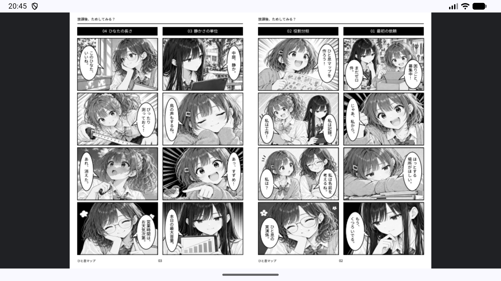
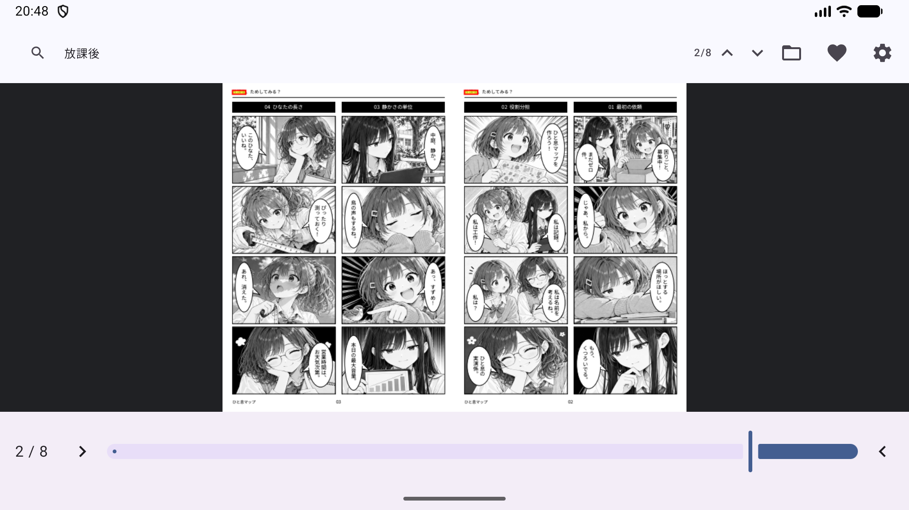
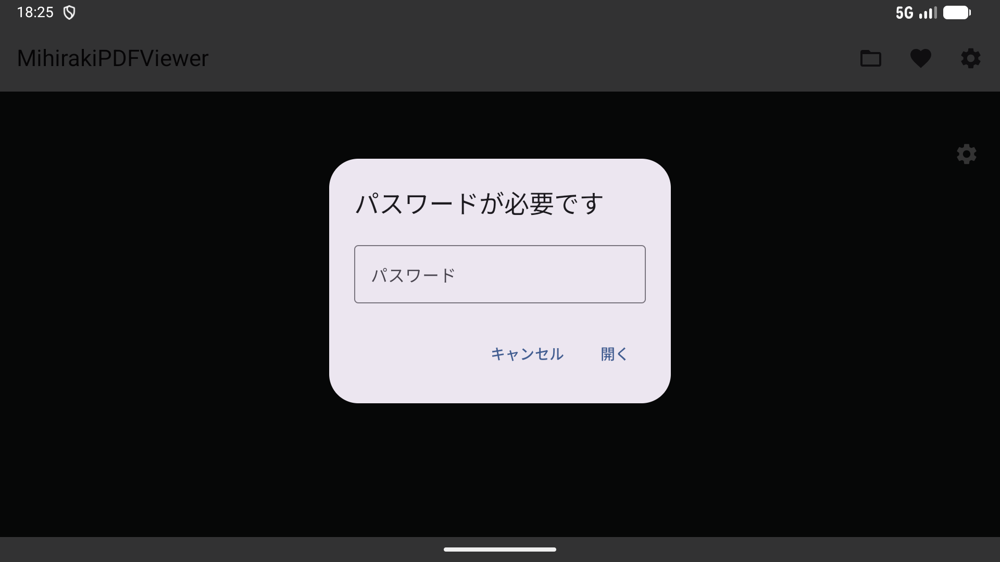
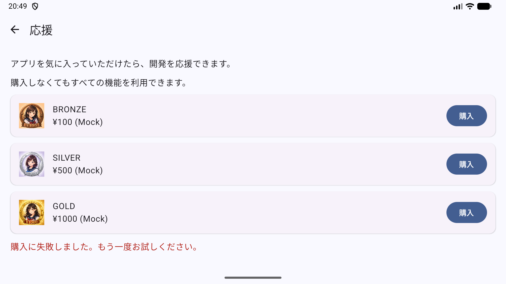
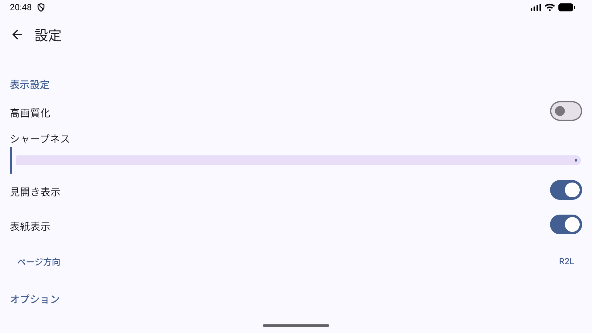

# 見開きPDFビューア (MihirakiPDFViewer) for Android

[](https://play.google.com/store/apps/details?id=com.github.tyamada.MihirakiPDFViewer_Android)
[](LICENSE)
[](https://qiita.com/tyamada22/stocks/8aeb6d899f7e0257f1d2)

[English](README.md) | 日本語

**見開きPDFビューア** (**MihirakiPDFViewer**) は、日本特有の「右綴じ」や「見開き」ドキュメント（漫画やライトノベルなど）を快適に閲覧するために設計された、プライバシー重視のモダンな Android 用ローカル PDF ビューアです。

**Kotlin**、**Jetpack Compose**、**Material 3** を使用し、**MVVM** アーキテクチャに基づいて構築されています。

## ✨ 主な機能

- 📖 **見開き表示対応**: 2つのページを横に並べてシームレスに表示します。
- 📑 **PDF目次（アウトライン）ツリーナビゲーション**: PDFに埋め込まれた目次やブックマークを自動抽出し、ワンタップで任意の章・節へジャンプできます。
- ☰ **プルダウンメニュー & 専用画面**: トップバーの設定アイコンから「設定」「ヘルプ」「バージョン」「診断」「応援」へスムーズにアクセス。アコーディオン形式のヘルプ画面や専用のバージョン・診断ハブ画面を完備。
- 🔄 **自動構成検出**: PDF のメタデータからページレイアウト（単一/見開き）と読書方向（左綴じ/右綴じ）を自動的に検出し、最適な設定を適用します。
- 🇯🇵 **右綴じ（R2L）完全対応**: 日本の書籍特有の右から左への読書順序や、右綴じの製本レイアウトをネイティブにサポート。
- 🔍 **強力な検索機能**: 高速なテキスト検索に加え、ヒット箇所を精密にハイライト（黄色背景と赤枠）表示します。
- 🛡️ **プライバシー重視**: PDF 処理にインターネット接続は不要です。Storage Access Framework (SAF) を使用し、ユーザーが明示的に選択したファイルのみにアクセスします。
- 🚀 **高性能レンダリング**: Android 標準の `PdfRenderer` を使用し、互換性と機能向上のために `PDFBox-Android` をフォールバックとして併用します。
- 🎨 **アダプティブ UI & 折りたたみ端末対応**: `BoxWithConstraints` を活用し、スマートフォンからタブレット、折りたたみ端末まで画面サイズに最適化されたレスポンシブデザイン。
- ♿ **アクセシビリティ（A11y）対応 & 自動診断テスト**: TalkBack読み上げセマンティクスおよび Espresso AccessibilityChecks による自動テスト検証を統合。
- 🖱️ **デスクトップ・マウス端クリックページ送り**: デスクトップまたはマウス操作モードにおいて、PDF画像の左右端をクリックすることで直感的にページ送り可能（設定画面で切り替え可能）。
- 📱 **縦向きでは単一ページ表示**: 縦長画面（Portrait）のときに自動で単一ページ表示にする機能を搭載（デフォルトで有効、設定画面で切替可能）。
- 📋 **診断・アプリログ管理**: 端末診断テストの実行や、ローカルでのアプリログ保存・共有機能を搭載。ログは端末内に最大24時間安全に保存され、個人情報やファイルの内容は一切記録されません（自動外部送信なし）。

> [!NOTE]
> **インターネット接続について**: 端末内のPDF閲覧はオフラインで利用できます。サンプル取得、クラウドストレージ、更新確認、応援購入・購入情報の復元には通信が必要です。外部リンクを開く場合も通信を利用します。

## 📱 スクリーンショット

| ビューア（見開き） | 検索 | パスワード保護 | 応援 | 設定 |
| :---: | :---: | :---: | :---: | :---: |
|  |  |  |  |  |

## 🛠 技術スタック

- **言語**: [Kotlin](https://kotlinlang.org/)
- **UI フレームワーク**: [Jetpack Compose](https://developer.android.com/jetpack/compose)
- **デザインシステム**: [Material 3](https://m3.material.io/)
- **アーキテクチャ**: MVVM (Model-View-ViewModel)
- **PDF エンジン**: 標準 `PdfRenderer` + [PDFBox-Android](https://github.com/TomRoush/PdfBox-Android)
- **ローカルストレージ**: [Jetpack DataStore](https://developer.android.com/topic/libraries/architecture/datastore) (Preferences)
- **ナビゲーション**: [Jetpack Navigation Compose](https://developer.android.com/jetpack/compose/navigation)
- **アプリ内課金**: [Google Play Billing Library](https://developer.android.com/google/play/billing) (開発者応援チップ用)

## 🚀 はじめに

### 動作要件
- プロジェクトのGradle／Android Gradle PluginとJDK 21に対応するAndroid Studio
- JDK 21
- Android SDK 37

### ビルド方法
1. リポジトリをクローンします:
   ```bash
   git clone https://github.com/tyamada/MihirakiPDFViewer_Android.git
   ```
2. Android Studio でプロジェクトを開きます。
3. Gradle ファイルと同期します。
4. エミュレーターまたは実機（minSdk 26 以上）で実行します。

## 📚 サンプルPDF

サンプルPDFは初期状態で最新話順に表示します。第1話順／最新話順を切り替えられ、選択した順序は保存され、言語で絞り込んだ場合にも適用されます。

以下のサンプルPDFファイルで MihirakiPDFViewer をお試しください：
- [Klub Coba-Coba Episode 1 (Bahasa Indonesia (Indonesian))](https://github.com/tyamada/MihirakiPDFViewer_Android/releases/download/sample-manga-v1/tameshibu_episode1_id.pdf) (23MB)
- [Klub Coba-Coba Episode 2 (Bahasa Indonesia (Indonesian))](https://github.com/tyamada/MihirakiPDFViewer_Android/releases/download/sample-manga-v1/tameshibu_episode2_id.pdf) (24MB)
- [Klub Coba-Coba Episode 3 (Bahasa Indonesia (Indonesian))](https://github.com/tyamada/MihirakiPDFViewer_Android/releases/download/sample-manga-v1/tameshibu_episode3_id.pdf) (22MB)
- [DER PROBIERCLUB FOLGE 1 (Deutsch (German))](https://github.com/tyamada/MihirakiPDFViewer_Android/releases/download/sample-manga-v1/tameshibu_episode1_2_de.pdf) (23MB)
- [DER PROBIERCLUB FOLGE 2 (Deutsch (German))](https://github.com/tyamada/MihirakiPDFViewer_Android/releases/download/sample-manga-v1/tameshibu_episode2_2_de.pdf) (24MB)
- [DER PROBIERCLUB FOLGE 3 (Deutsch (German))](https://github.com/tyamada/MihirakiPDFViewer_Android/releases/download/sample-manga-v1/tameshibu_episode3_de.pdf) (22MB)
- [THE TRY-IT CLUB EPISODE 1 THE BREAK-TIME MAP (English (English))](https://github.com/tyamada/MihirakiPDFViewer_Android/releases/download/sample-manga-v1/tameshibu_episode1_2_en.pdf) (23MB)
- [THE TRY-IT CLUB EPISODE 2 ROOM TO GROW (English (English))](https://github.com/tyamada/MihirakiPDFViewer_Android/releases/download/sample-manga-v1/tameshibu_episode2_2_en.pdf) (24MB)
- [THE TRY-IT CLUB EPISODE 3 OUT AND ABOUT (English (English))](https://github.com/tyamada/MihirakiPDFViewer_Android/releases/download/sample-manga-v1/tameshibu_episode3_en.pdf) (22MB)
- [El Club de Pruebas Episodio 1 (Español (Spanish))](https://github.com/tyamada/MihirakiPDFViewer_Android/releases/download/sample-manga-v1/tameshibu_episode1_es.pdf) (23MB)
- [El Club de Pruebas Episodio 2 (Español (Spanish))](https://github.com/tyamada/MihirakiPDFViewer_Android/releases/download/sample-manga-v1/tameshibu_episode2_es.pdf) (24MB)
- [El Club de Pruebas Episodio 3 (Español (Spanish))](https://github.com/tyamada/MihirakiPDFViewer_Android/releases/download/sample-manga-v1/tameshibu_episode3_es.pdf) (22MB)
- [Ang Try-It Club Episode 1 (Filipino (Filipino))](https://github.com/tyamada/MihirakiPDFViewer_Android/releases/download/sample-manga-v1/tameshibu_episode1_tl.pdf) (23MB)
- [Ang Try-It Club Episode 2 (Filipino (Filipino))](https://github.com/tyamada/MihirakiPDFViewer_Android/releases/download/sample-manga-v1/tameshibu_episode2_tl.pdf) (24MB)
- [Ang Try-It Club Episode 3 (Filipino (Filipino))](https://github.com/tyamada/MihirakiPDFViewer_Android/releases/download/sample-manga-v1/tameshibu_episode3_tl.pdf) (22MB)
- [LE CLUB DES ESSAIS EPISODE 1 (Français (French))](https://github.com/tyamada/MihirakiPDFViewer_Android/releases/download/sample-manga-v1/tameshibu_episode1_2_fr.pdf) (23MB)
- [LE CLUB DES ESSAIS EPISODE 2 (Français (French))](https://github.com/tyamada/MihirakiPDFViewer_Android/releases/download/sample-manga-v1/tameshibu_episode2_2_fr.pdf) (24MB)
- [LE CLUB DES ESSAIS EPISODE 3 (Français (French))](https://github.com/tyamada/MihirakiPDFViewer_Android/releases/download/sample-manga-v1/tameshibu_episode3_fr.pdf) (22MB)
- [Il Club delle Prove Episodio 1 (Italiano (Italian))](https://github.com/tyamada/MihirakiPDFViewer_Android/releases/download/sample-manga-v1/tameshibu_episode1_it.pdf) (23MB)
- [Il Club delle Prove Episodio 2 (Italiano (Italian))](https://github.com/tyamada/MihirakiPDFViewer_Android/releases/download/sample-manga-v1/tameshibu_episode2_it.pdf) (24MB)
- [Il Club delle Prove Episodio 3 (Italiano (Italian))](https://github.com/tyamada/MihirakiPDFViewer_Android/releases/download/sample-manga-v1/tameshibu_episode3_it.pdf) (22MB)
- [O Clube de Testes Episódio 1 (Português (Portuguese))](https://github.com/tyamada/MihirakiPDFViewer_Android/releases/download/sample-manga-v1/tameshibu_episode1_pt.pdf) (23MB)
- [O Clube de Testes Episódio 2 (Português (Portuguese))](https://github.com/tyamada/MihirakiPDFViewer_Android/releases/download/sample-manga-v1/tameshibu_episode2_pt.pdf) (24MB)
- [O Clube de Testes Episódio 3 (Português (Portuguese))](https://github.com/tyamada/MihirakiPDFViewer_Android/releases/download/sample-manga-v1/tameshibu_episode3_pt.pdf) (22MB)
- [Câu Lạc Bộ Thử Nghiệm Tập 1 (Tiếng Việt (Vietnamese))](https://github.com/tyamada/MihirakiPDFViewer_Android/releases/download/sample-manga-v1/tameshibu_episode1_vi.pdf) (23MB)
- [Câu Lạc Bộ Thử Nghiệm Tập 2 (Tiếng Việt (Vietnamese))](https://github.com/tyamada/MihirakiPDFViewer_Android/releases/download/sample-manga-v1/tameshibu_episode2_vi.pdf) (24MB)
- [Câu Lạc Bộ Thử Nghiệm Tập 3 (Tiếng Việt (Vietnamese))](https://github.com/tyamada/MihirakiPDFViewer_Android/releases/download/sample-manga-v1/tameshibu_episode3_vi.pdf) (22MB)
- [द ट्राइ-इट क्लब एपिसोड १ (नेपाली (Nepali))](https://github.com/tyamada/MihirakiPDFViewer_Android/releases/download/sample-manga-v1/tameshibu_episode1_ne.pdf) (23MB)
- [द ट्राइ-इट क्लब एपिसोड २ (नेपाली (Nepali))](https://github.com/tyamada/MihirakiPDFViewer_Android/releases/download/sample-manga-v1/tameshibu_episode2_ne.pdf) (24MB)
- [द ट्राइ-इट क्लब एपिसोड ३ (नेपाली (Nepali))](https://github.com/tyamada/MihirakiPDFViewer_Android/releases/download/sample-manga-v1/tameshibu_episode3_ne.pdf) (22MB)
- [해봄부 제1화 한숨 돌림 지도 (한국어 (Korean))](https://github.com/tyamada/MihirakiPDFViewer_Android/releases/download/sample-manga-v1/tameshibu_episode1_2_ko.pdf) (23MB)
- [해봄부제2화 책상이 넓어지다 (한국어 (Korean))](https://github.com/tyamada/MihirakiPDFViewer_Android/releases/download/sample-manga-v1/tameshibu_episode2_2_ko.pdf) (24MB)
- [해봄부 제3화 출장, 해봄부! (한국어 (Korean))](https://github.com/tyamada/MihirakiPDFViewer_Android/releases/download/sample-manga-v1/tameshibu_episode3_ko.pdf) (22MB)
- [ためし部 第１話 ひと息マップ (日本語 (Japanese))](https://github.com/tyamada/MihirakiPDFViewer_Android/releases/download/sample-manga-v1/tameshibu_episode1_2_ja.pdf) (23MB)
- [ためし部 第２話 机、ひろがる。 (日本語 (Japanese))](https://github.com/tyamada/MihirakiPDFViewer_Android/releases/download/sample-manga-v1/tameshibu_episode2_2_ja.pdf) (24MB)
- [ためし部 第３話 出張、ためし部！ (日本語 (Japanese))](https://github.com/tyamada/MihirakiPDFViewer_Android/releases/download/sample-manga-v1/tameshibu_episode3_ja.pdf) (22MB)
- [试试社 第1话 歇口气地图 (简体中文 (Chinese (Simplified)))](https://github.com/tyamada/MihirakiPDFViewer_Android/releases/download/sample-manga-v1/tameshibu_episode1_2_zh_cn.pdf) (23MB)
- [试试社 第2话 桌子变大了 (简体中文 (Chinese (Simplified)))](https://github.com/tyamada/MihirakiPDFViewer_Android/releases/download/sample-manga-v1/tameshibu_episode2_2_zh_cn.pdf) (24MB)
- [试试社 第3话 出差，试试社！ (简体中文 (Chinese (Simplified)))](https://github.com/tyamada/MihirakiPDFViewer_Android/releases/download/sample-manga-v1/tameshibu_episode3_zh_cn.pdf) (22MB)
- [試試社 第1話 (繁體中文 (Chinese (Traditional)))](https://github.com/tyamada/MihirakiPDFViewer_Android/releases/download/sample-manga-v1/tameshibu_episode1_2_zh_tw.pdf) (23MB)
- [試試社 第2話 (繁體中文 (Chinese (Traditional)))](https://github.com/tyamada/MihirakiPDFViewer_Android/releases/download/sample-manga-v1/tameshibu_episode2_2_zh_tw.pdf) (24MB)
- [試試社 第3話 (繁體中文 (Chinese (Traditional)))](https://github.com/tyamada/MihirakiPDFViewer_Android/releases/download/sample-manga-v1/tameshibu_episode3_zh_tw.pdf) (22MB)

### サンプルPDFのライセンスと表示
**『ためし部』第1話・第2話**
© 2026 こまいろ日和

本作品のうち、公開者が著作権その他の許諾対象となる権利を有する部分を、Creative Commons 表示 4.0 国際（CC BY 4.0）で提供します。
https://creativecommons.org/licenses/by/4.0/

再利用時は、作品名、作者名「こまいろ日和」、原作品の公開元、ライセンスへのリンクを表示し、変更した場合はその旨を明示してください。

本作品は、文章・画像の制作および翻訳に生成AIを使用しています。フォントなど第三者に権利がある素材には、それぞれのライセンスが適用されます。著作権等による保護を受けない部分の利用を、この表示によって制限するものではありません。

## 🧪 テストと診断機能
ユニットテストおよびインストルメンテーション UI テストを実行できます。テスト用の PDF ファイルは [こちら](https://1drv.ms/f/c/7a27b2713c2c2c38/IgDLhBYHJMKbRrvH92OpdA6jAQ4VUZNjFrJhqSYs9W4-BTo?e=JaNqSa) から入手可能です。
```bash
./gradlew test
./gradlew connectedAndroidTest
```
- **Play版の情報収集（インストール・データ変更なし）**: `python3 scripts/run_device_tests_and_save.py --serial DEVICE_SERIAL` で、選択端末の実インストール版と限定した端末情報を `logs/` に保存します。情報収集の成功は機能試験の合格を意味しません。設定保持・購入権利・TalkBackは[更新確認手順](docs/DEVICE_TEST_CHECKLIST.ja.md)で手動確認します。
- **専用テスト端末のDebug自動試験**: `python3 scripts/run_device_tests_and_save.py --serial DEVICE_SERIAL --mode debug` で、Debugビルド・データ保持インストール・起動・単体・端末・Python試験を実行します。Playからインストールしたアプリの置換は拒否します。クリーン試験のみ `--clean-install --confirm-clean DEVICE_SERIAL` を追加します（テストアプリのデータ削除）。必須工程の失敗は非ゼロ終了となり、手動確認は未完了のまま記録。動作確認一覧は自動上書きしません。
- 環境設定・保存結果・制約は[実機テストガイド](DEV_TESTING_GUIDE.md)を参照。ログは共有前に内容を確認してください。
- **アプリ内診断ログ**: 設定画面の「Testing & Diagnostics」から、リアルタイムのメモリ使用量や、インメモリバッファに記録されたアプリケーションログ (`AppLogger`) を確認できます。
- **パフォーマンス・ストレステスト**: 大容量PDFのメモリトラッキングテスト、高速ページめくりストレステスト、連続ドキュメント切り替え安定性テストが含まれています。

## 🤖 CI (継続的インテグレーション)
GitHub Actions (`.github/workflows/ci.yml`) を利用した自動ビルドおよびテスト検証パイプラインを構築しています。
- **対象ブランチ**: `main`, `testing` (プッシュおよびプルリクエスト時)
- **検証内容**:
  - JDK 21 環境のセットアップ
  - デバッグ APK のビルド (`./gradlew assembleDebug`)
  - Android Lint (`./gradlew lintDebug`)
  - JVM 単体テストの実行 (`./gradlew testDebugUnitTest`)
  - 翻訳リソース・ストア原稿・公開ページ検査と実機スクリプトの回帰試験
  - テスト・Lint結果をCI成果物として保存（署名鍵は不要）

## 📋 動作確認リスト
開発者およびユーザーによって検証されたデバイス互換性や動作確認の結果は、[VERIFICATION_LIST.md](VERIFICATION_LIST.md) に記載されています。

## 💖 開発者の応援
アプリを気に入っていただけた場合は、アプリ内の「応援」機能から開発を支援できます。Bronze、Silver、Gold、および Ver.2.0公開記念こよみバッジの各チップをご用意しており（Google Play Consoleのプロモーションコードによる無料引き換えにも対応）、設定画面に特別な記念バッジが表示されます！

## 🐛 不具合・問題の報告 (GitHub Issues)
アプリの不具合や予期せぬ動作、クラッシュなどが発生した場合は、[GitHub Issues](https://github.com/tyamada/MihirakiPDFViewer_Android/issues) よりご報告ください。
ご報告の際は以下の情報を記載していただくとスムーズです：
1. **アプリのバージョン & ビルドコード**（例: v2.1.4, Code 43）
2. **端末モデル & Androidバージョン**（例: Pixel 8, Android 15）
3. **問題を再現する手順**
4. **診断ログ**: 設定画面の「Testing & Diagnostics」からアプリログをコピーまたは共有して添付してください。添付前にログを確認し、個人情報を除いてください。

## 📖 Qiita 連載・記事
本アプリの開発に関する連載・技術記事は [Qiita 連載ストックリスト](https://qiita.com/tyamada22/stocks/8aeb6d899f7e0257f1d2) にまとめています。

## 🤖 AI による開発
このプロジェクトは、AI アシスタントを活用して開発されています：
- **初期コード作成**: [ChatGPT](https://chat.openai.com/)
- **コードの変更・機能追加・バグ修正**: [Gemini 3.0 Flash Preview](https://deepmind.google/technologies/gemini/flash/) (Android Studio 経由)

## 📜 バージョン履歴

- **v2.1.4（コード44）— 2026-11-02 内部テスト配信**
  - 文字拡大時の応援画面の表示切れ・スクロール不可を修正。商品説明と購入ボタンを縦に配置。Pixel 8a（Android 17）でスクロール・TalkBack・購入済み表示の再確認合格報告を受領。

- **v2.1.4（コード43）— 2026-11-02 内部テスト配信**
  - サンプルPDFの順序保存、翻訳・アイコン更新、読み上げ説明、狭い画面の検索、外部PDF遷移、設定保存を改善。
  - 実機での更新前後の保持・購入権利・TalkBackは確認中。製品版の公開告知ではありません。
- **v2.1.3（コード42）— 製品版の基準**
  - 内部テスト配信前に記録した製品版。過去の公開タグは[GitHub Releases](https://github.com/tyamada/MihirakiPDFViewer_Android/releases)を参照してください。

過去のREADMEでは異なる変更に2.1.3が繰り返し付いていたため、根拠のない旧版番号は割り当てず整理しました。元の記録はGit履歴で確認できます。応援購入はGoogle Playの非消耗型商品で、閲覧機能を制限するものではありません。

## 📄 ライセンス
このプロジェクトは MIT License の下でライセンスされています。詳細は [LICENSE](LICENSE) ファイルを参照してください。

---
*注: このアプリはローカルファイル閲覧用に最適化されており、ドキュメントをサーバーにアップロードすることはありません。*

### サンプルPDFの配布

42件のサンプル漫画PDFは[GitHub Releases](https://github.com/tyamada/MihirakiPDFViewer_Android/releases/tag/sample-manga-v1)から配布します。旧アプリ向けのGitHub Pages上のPDFと既存URLは維持します。[移行・検証記録](docs/SAMPLE_PDF_RELEASE_MIGRATION.ja.md)を参照してください。
